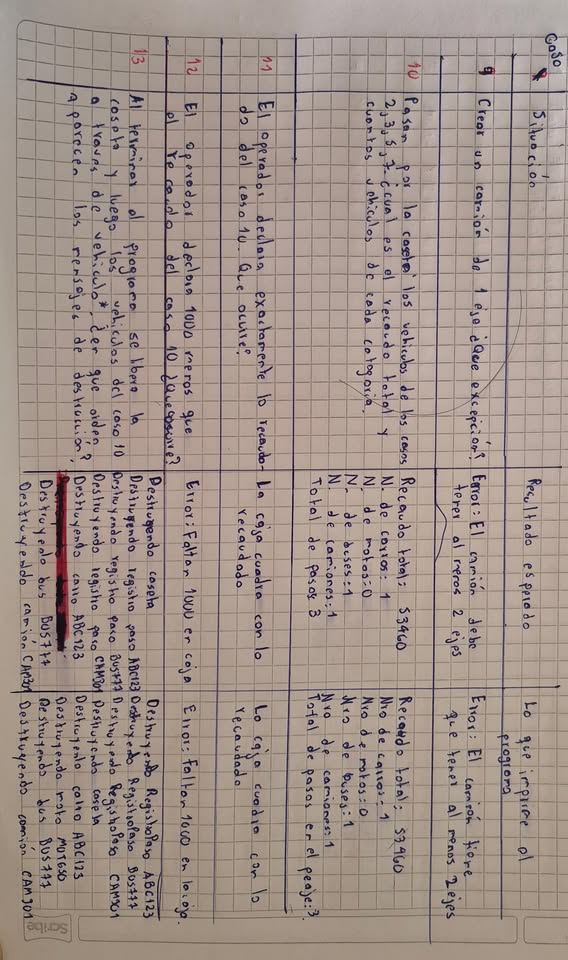
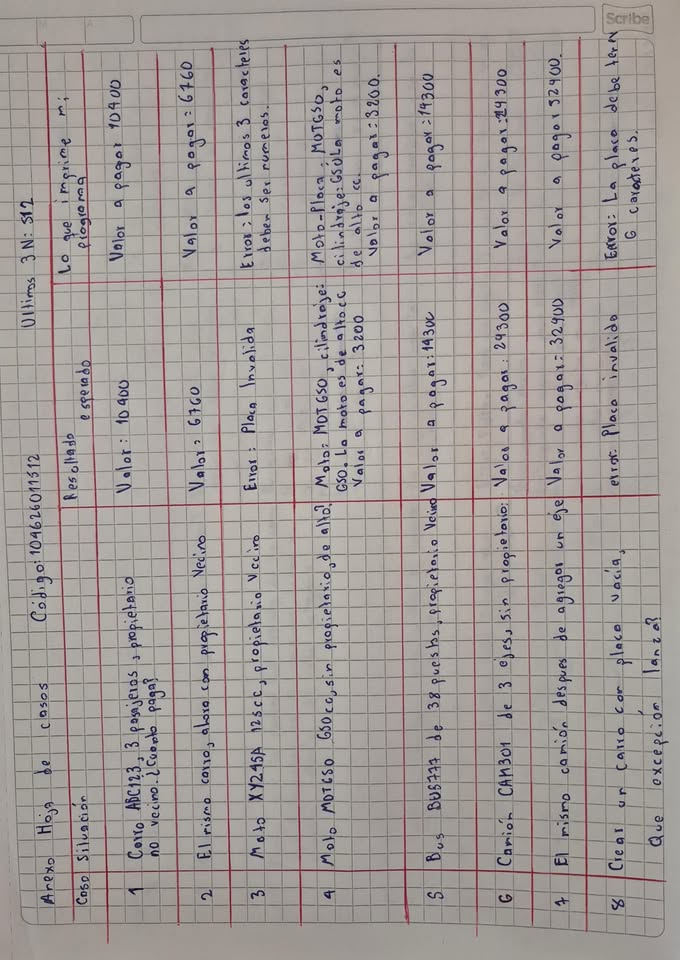

104626011512
# ProyectoDG
Porque no se puede crear un objeto de vehiculo directmente?
-Porque Vehiculo es una clase abstracta, porque el metodo virtual cobrar() es puro.

Porque el destructor de Vehiculo es virtual?
-Para hacer que cuando se elimine un vehiculo por medio de un puntero se ejecute el destructor de su clase derivada tambien.

Que hace tu programa si se llama al registro de un paso con un puntero nulo y por qué decidiste eso?
-se verifica si el puntero es nulo antes de registrar, si es nulo lanza una excepcion para que no continue con esa accion.

